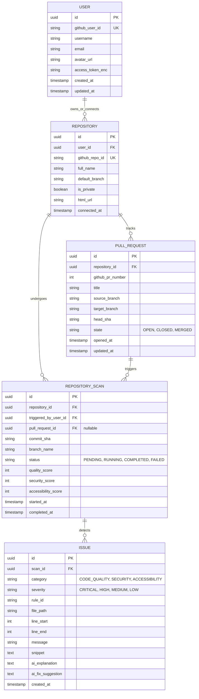

# DevPilot Data Model

This document outlines the core entities and relational schemas for DevPilot as defined in Phase 1 (Foundation) and expanded through subsequent phases.

---

## Entity Descriptions

### `User`
Stores authenticated developers connecting via GitHub OAuth2. Handles user identity and credentials.

### `Repository`
Stores connected GitHub repositories monitored by DevPilot. Contains sync settings, webhook secrets, and metadata.

### `RepositoryScan`
Represents an individual scan execution against a specific commit and branch. Aggregates overall scores and tracks lifecycle status across worker stages.

### `PullRequest`
Tracks active and historical PRs analyzed by DevPilot via GitHub webhooks. Correlates scans directly to PR reviews.

### `Issue`
Normalized findings model produced by all scanner engines:
- **Code Quality**: Checkstyle, PMD, SpotBugs, ESLint
- **Security**: Dependency vulnerabilities (CVEs), secret leaks, unsafe configurations
- **Accessibility**: axe-core violations, WCAG criteria tags, HTML element selectors
- **AI Fields**: Enriched with AI remediation, explanations, and patch suggestions
